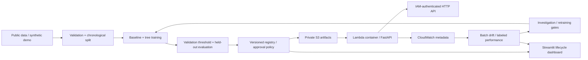

# Sentinel MLOps

A portable tabular ML platform for fraud detection, with reproducible training,
policy-controlled model promotion, batch drift monitoring, real HTTP inference and a
cost-conscious AWS deployment definition.

Sentinel is an engineering portfolio project. The deterministic demonstration trains
real estimators on explicitly synthetic records. AWS resources and production outcomes
are claimed only after deployment and verification. See [limitations](docs/limitations.md)
for the boundary between implemented behavior and operational evidence.

Delivery scope: local implementation and documented AWS deployment. No AWS deployment
is requested or performed. See [verified execution](docs/verification.md) for measured
public benchmark results and local recovery evidence.

## Architecture



Python and scikit-learn own the portable ML boundary. FastAPI and Mangum expose one
inference application locally and on Lambda. Terraform defines private S3, ECR,
versioned Lambda inference, an IAM-authorized API, alarms and orchestration. Lambda
alias weights support actual canary routing when deployed. Local demonstration events
are labeled separately from AWS events.

Read the [architecture](docs/architecture.md), [ADRs](docs/adr/) and
[cloud runbook](docs/runbooks/) for state ownership, tradeoffs and operating procedures.

## Run locally

Prerequisites: Python 3.12 and [uv](https://docs.astral.sh/uv/). Docker and Terraform
are needed only for container and infrastructure verification. No AWS credentials are
required for local training, tests, inference or dashboard use.

```sh
uv sync --locked
uv run sentinel train --output artifacts/demo
uv run sentinel demo --output artifacts/demo
uv run uvicorn sentinel.api:app --host 127.0.0.1 --port 8000
```

In a second terminal:

```sh
uv run streamlit run dashboard/app.py
```

Open the local API documentation at `http://127.0.0.1:8000/docs` to inspect the
prediction schema. `GET /healthz` checks the process; `GET /readyz` checks whether a
model is loaded. `POST /predict` accepts a `features` object with exactly the names
stored in the trained artifact and rejects missing, additional or non-finite values.
Responses include probability, thresholded decision, model version, request ID and
latency. Logs omit raw features and payment identifiers.

The Makefile offers `make install`, `make check`, `make test`, `make train`, `make demo`,
`make serve`, `make dashboard`, `make deploy`, `make destroy` and `make cost-check`.
On Windows without Make, use the corresponding commands in [Makefile](Makefile).

## Data and evaluation

The public benchmark is the [ULB/Worldline Credit Card Fraud Detection dataset](https://www.kaggle.com/datasets/mlg-ulb/creditcardfraud).
It has 284,807 transactions and 492 frauds across two days. PCA anonymization protects
source features but prevents business interpretation and realistic account-level
leakage checks. The license concerns both database and contents; acquisition and
attribution details are in [data/README.md](data/README.md). Do not commit raw data.

```sh
uv run sentinel acquire --output data/raw/creditcard.csv
uv run sentinel train --data data/raw/creditcard.csv --output artifacts/public
```

The synthetic demo uses a small deterministic numeric table for development and
integration tests. Synthetic metrics are software evidence, not fraud benchmark
results. Public-data acquisition is separate so CI stays bounded and reproducible.

Training validates numeric schema and binary outcomes, removes exact duplicates and
uses chronological 60/20/20 partitions. Scaling fits only on training data. A balanced
logistic baseline and gradient-boosted tree challenger train with fixed seeds; the
validation partition determines model and threshold. The test partition is held out
until evaluation. Preserve dataset fingerprints, feature order, seed, metrics,
threshold and serialized fitted pipeline with the run.

Evaluate PR-AUC, ROC-AUC, precision, recall, F1, false-positive rate, latency and a
business cost proxy. The demonstration assumes a 5-unit false-positive cost and
100-unit false-negative cost. Lowering the threshold usually catches more fraud while
blocking more legitimate transactions. The selected threshold minimizes validation
cost; it is not tuned on test results. These illustrative costs must be replaced by an
approved use-case policy before real financial decisions.

The core experiment record is a portable JSON report and versioned model artifact.
Optional MLflow tracking can persist runs without a permanently running tracking
server. Install the tracking extra when using it. The local registry is auditable
single-writer state; promotion requires explicit approval, minimum quality and
champion-regression checks. This local approval input is not an identity provider.

```sh
uv sync --extra tracking
uv run sentinel train --output artifacts/demo --tracking-uri sqlite:///artifacts/mlflow.db
uv run sentinel registry state --root artifacts/demo
```

Use `uv run sentinel registry promote --help` for explicit local promotion inputs.
Checksum provenance and immutable artifacts provide dataset/model version identity.
DVC is initialized for local dataset versioning and reproducible pipeline execution;
the generated `.dvc` metadata records data identity without committing raw records.
The optional S3 DVC remote requires authorization and has not been synchronized.
JSON records and optional SQLite MLflow tracking provide experiment history with a
documented single-writer boundary. The advanced estimator uses scikit-learn histogram gradient boosting rather
than a second tree framework, reducing packaging and training/serving compatibility
surface for the Lambda demonstration.

```sh
uvx --from dvc==3.67.1 dvc status
uvx --from dvc==3.67.1 dvc repro
```

See [data provenance](data/README.md) before configuring a remote; S3 storage and
requests can incur charges and require explicit spending authorization.

## Monitoring and retraining

Monitoring compares numeric reference and current batches using two-sample
Kolmogorov–Smirnov tests, multiple-comparison correction and a practical effect-size
guard. Quality checks report missing features, invalid values and insufficient
observations. Evidently is an optional reporting adapter.

Data drift describes changed input distributions. It does not establish concept drift
or performance degradation. Labeled outcomes support separate precision/recall and
cost evaluation; delayed labels require an application-specific prediction/outcome
join. `sentinel outcomes` implements a strict request-ID join and reports label coverage
and per-version performance using logged decision thresholds; source ingestion remains
application-specific. A drift alert requests investigation and evaluation, rather than automatically
replacing the champion. Retraining requires labeled observations and passes the same
comparison and approval gates as initial training.

```sh
uv run sentinel monitor --reference artifacts/demo/reference.csv --current data/raw/current.csv --output artifacts/monitor.json
```

The current CSV must contain the same feature names as the reference. Supply delayed
`target` and `probability` columns only after the corresponding outcomes are known.
Install `uv sync --extra drift` and pass `--evidently` for an additional HTML report.

```sh
uv run sentinel outcomes --predictions artifacts/demo/predictions.jsonl --labels data/raw/outcomes.csv --output artifacts/performance.json
uv run sentinel registry promote --root artifacts/demo --version VERSION --approve --policy configs/promotion.json
```

Outcome CSVs contain unique `request_id,target` pairs. Partial coverage is reported;
selectively observed labels can bias performance estimates. New-data retraining excludes
the final 20% as a common evaluation cohort for both champion and candidate, then
applies fixed thresholds and the promotion policy. The main demo rejects regressions;
a separately labeled recovery fixture permits a wider regression tolerance solely to
exercise promotion and rollback of actual trained artifacts after a simulated failure.

The local scenario demonstrates normal operation, shifted observations, an alert,
labeled retraining, challenger evaluation, approval/rejection and recovery behavior.
Its events are synthetic workflow evidence. It does not represent AWS traffic splitting
or an external payment stream.

## AWS deployment and costs

Run the non-deploying check before any cloud change:

```sh
uv run python scripts/cloud.py cost-check
```

Deployment needs working AWS credentials, a selected account and region, a budget
notification email, a reviewed Terraform plan and **explicit spending authorization**.
No billable infrastructure is authorized by running local development commands.
The target demonstration cost is below USD 15, with a USD 20 planning ceiling.
Neither estimates nor AWS Budgets notifications enforce a spending cap. See the
runbook for workload assumptions, recurring storage charges and current pricing links.

The design avoids NAT Gateways, always-on EC2, managed tracking databases, SageMaker
endpoints, load balancers and Kubernetes. Training runs locally; inference is bounded
with conservative concurrency, throttles, timeouts and log retention. S3 and ECR may
continue charging for retained objects/images after compute is idle.

`make deploy` and `make destroy` delegate to the guarded cloud helper. Teardown must
confirm project ownership and inspect retained versioned artifacts; unrelated resources
must never be deleted. Infrastructure validation alone does not verify deployment.

## Quality and delivery

```sh
uv run ruff format --check .
uv run ruff check .
uv run mypy src tests dashboard scripts
uv run pytest
uv run pip-audit
uv run bandit -q -r src scripts
```

GitHub Actions validates formatting, linting, types, unit/integration behavior,
dependencies, container builds and Terraform. Deployment is manually dispatched and
must pass an explicit authorization input and a protected production environment.
Configure required reviewers in GitHub; a workflow's environment name alone does not
create human approval protection. OIDC avoids long-lived AWS access keys in CI.

Inference uses an IAM-authorized cloud route, encrypted private artifact storage and
trusted model digests. Deserializing joblib executes Python object loading and must
only consume trusted artifacts. Preserve Terraform state securely and keep credentials,
datasets and generated model binaries out of Git.

## Evidence and next steps

The final verification record reports actual commands, test results, measured metrics
and any unavailable tools. Check [limitations](docs/limitations.md) before interpreting
the demonstration. Cloud deployment, canary traffic and recovery are outside this
delivery's requested execution scope. The runbook explains verification for future deployment.

Production extensions include authenticated reviewer identities, transactional registry
state, delayed-label ingestion, confidence intervals for promotion decisions,
representative load tests and longer-horizon evaluation on relevant business data.
