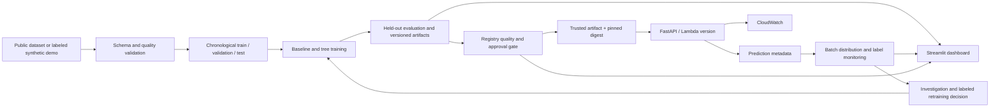

# Architecture and operational boundaries

Sentinel separates portable tabular ML from its AWS deployment adapter. Training,
validation, threshold selection, model registration and monitoring run locally without
cloud credentials. A FastAPI application serves the serialized preprocessing and
estimator pipeline. AWS supplies private artifact storage, bounded serverless inference
and explicit orchestration rather than an always-running training cluster.

## Training and evaluation

The use-case adapter produces a numeric table with binary target and a temporal
column. Split before fitting preprocessing. Fit preprocessing and estimators only on
training rows; choose the decision threshold from validation predictions; report final
quality on untouched test rows. Preserve feature names and ordering in the model
artifact so inference applies the same fitted pipeline. Use PR-AUC and business cost
as decision metrics, with recall and false-positive regression guards. Accuracy alone
conceals errors under severe class imbalance.

A false negative represents missed fraud; a false positive represents a legitimate
transaction blocked for review. Their configured costs determine the selected
threshold. Demonstration costs express an illustrative policy, not measured bank losses.
Latency measurements describe the local execution environment and exclude network
round trips and AWS cold starts.

## Model state and deployment state

The portable JSON registry is a local, single-writer audit record with atomic file
replacement. It is suitable for reproducible demonstrations, not a distributed locking
service. Approval is an explicit input to a policy-checked promotion. It does not
establish the approver's identity. Artifact paths and model versions remain separate
from AWS Lambda deployment versions.

Production inference state is the Lambda version referenced by the `live` alias. A
published Lambda version pins its image and model configuration. Weighted alias routing
provides actual AWS request splitting when deployed. Promotion and rollback must update
that alias deliberately; changing a local registry cannot alter live AWS traffic.
Terraform state must be protected because it controls these resources. Model binaries
are executable pickle content and must come only from trusted build/deployment sources;
the deployment pins SHA-256 before deserialization.

## Monitoring semantics

Data quality checks detect schema, missing-value and non-finite-value failures. Numeric
distribution tests compare a batch with the training reference; statistical drift is
evidence of a changed distribution, not proof of worsening predictions or changed
label relationships. Concept drift requires labeled evidence and investigation. Delayed
labels must be joined to prediction identifiers under an application-specific retention
and privacy policy before performance evaluation. The demo's generated outcomes are
not a real payment processor integration.

Retraining requires sufficient labeled observations and follows the same evaluation,
comparison and approval gates as initial training. A drift flag cannot bypass them.
Batch jobs keep monitoring costs bounded and expose reports for inspection.

## Security and cost boundaries

The AWS adapter uses private encrypted S3 storage, an IAM-authorized HTTP API, narrowly
scoped Lambda artifact reads, short log retention, constrained concurrency and request
throttles. Repository workflows use dependency scans and deployment credentials supplied
through OIDC. No AWS secret keys belong in source control.

The demonstration budget target is below USD 15, with a USD 20 infrastructure planning
ceiling. Alerts, timeouts and concurrency limits reduce exposure but do not impose an
account spending cap. Training is local; AWS schedules are disabled by default. Deployment
requires an account/region check, a reviewed plan and explicit spending authorization.
Never delete resources that do not belong to this project. See the ADRs and cloud
runbook for the deployment sequence and teardown requirements.
