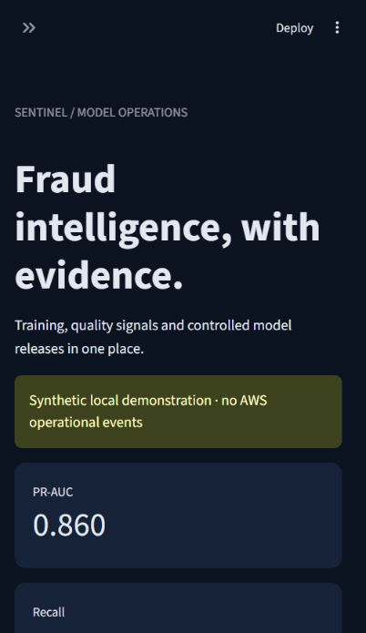

# Verified delivery — 2026-10-22

Requested scope is working local software and instructions for future AWS deployment.
No AWS resources were created. Cloud traffic, alerts, canary behavior and deployment
recovery have not been operationally verified and are outside the requested execution scope.

## Actual execution

- `uv run pytest -q`: **26 passed**, 22.77 seconds in the final local run.
- Ruff formatting/lint and mypy across source, tests, dashboard and scripts passed.
- `uv run --all-extras pip-audit`: no known vulnerabilities found at execution time.
- `uv run bandit -q -r src scripts`: passed. Reviewed subprocess calls use executable
  resolution, argument arrays and targeted documented exclusions; no shell execution.
- `detect-secrets` scanned staged repository content. Reported high-entropy values
  were reviewed: dataset/source/cohort checksums, model IDs and an inference request ID.
  No credential findings were identified. Dependency/provider lock hashes were excluded.
- Terraform 1.14.0 formatting and `validate` passed with locked AWS provider 6.70.0.
- Streamlit AppTest passed: four metric cards, three tabs, no application exceptions.
  The actual local page was inspected in the browser; its screenshot is below.
- DVC 3.67.1 initialized, acquired-data pointer added, training executed with `dvc repro`;
  final `dvc status` reported data and pipelines up to date. S3 remote sync was not run.
- MLflow 3.17.2 persisted runs in local SQLite; public-data run ID
  `d4f5d54d52cc497e9676425e2475df5c`. Model artifacts and reports persisted locally.
- Evidently 0.7.23 generated an actual HTML distribution report at
  `artifacts/delivery-demo/evidently.html` (generated reports remain outside Git).
- Actual public-model prediction through FastAPI TestClient returned HTTP 200 and the
  selected model version; readiness also passed. See [HTTP evidence](evidence/api-smoke.json).

## Public benchmark

Acquired 284,807 records / 492 frauds from the public CSV used by the
[official TensorFlow tutorial](https://www.tensorflow.org/tutorials/structured_data/imbalanced_data).
OpenML metadata and direct parquet requests returned HTTP 500; the verified public
TensorFlow mirror was used instead. License/provenance caveats are in [data notes](../data/README.md).

Exact deduplication removed 1,081 rows, leaving 283,726 records. Chronological
train/validation/test sizes were 170,235 / 56,745 / 56,746. The selected histogram
gradient boosting model used threshold 0.95, chosen on validation cost only.

| Held-out test measure | Observed |
|---|---:|
| PR-AUC (average precision) | 0.756624 |
| ROC-AUC | 0.983750 |
| Precision | 0.794118 |
| Recall | 0.729730 |
| F1 | 0.760563 |
| False positive rate | 0.000247 |
| False positives / false negatives | 14 / 20 |
| Assumed cost per transaction | 0.036478 units |

The baseline's test cost was 0.032513 units, lower than the selected tree's test cost.
Selection remains validation-only: the tree had lower validation cost (0.023262 versus
0.027315). This is evidence of selection uncertainty, not a claim that the advanced
model dominates the baseline. The split contains only 74 frauds in the test window;
confidence intervals and longer-horizon representative evaluation remain future work.

Detailed reports preserve both models' results and observed local latency:
[public evaluation](evidence/public-evaluation.json),
[synthetic evaluation](evidence/synthetic-evaluation.json).
Synthetic performance must not be presented as public benchmark performance.

## Lifecycle and recovery

The executed synthetic scenario recorded no drift under normal operation, drift after
a controlled feature shift, and an `awaiting_ground_truth` state for unlabeled data.
With labels available it trained a real candidate and compared both models on the
same excluded holdout. The default policy rejected a PR-AUC regression.

A separate local recovery fixture explicitly widened regression tolerances, promoted
actual versioned artifacts, and restored the prior model after a **simulated verification
failure**. The model artifacts and registry transitions are real; traffic and failure
injection are local simulation. The default policy remains strict.
See [lifecycle evidence](evidence/lifecycle.json) and [independent review](review.md).

## Remaining boundaries

| Area | Status / reason |
|---|---|
| AWS deployment, weighted traffic, delivered alerts | Documented and Terraform-validated; execution intentionally excluded by user |
| Local Docker image build | Not executed: Docker Desktop daemon unavailable; CI includes Linux build |
| Central MLflow / multiwriter registry | Local SQLite/JSON single-writer implementation; shared concurrent service not provisioned |
| Live delayed-label source | Strict join and coverage metrics implemented; real source ingestion, retention and identity policy require an operator integration |
| Human approval identity | CLI approval and manual GitHub environment gates implemented; reviewers/OIDC/account settings require repository/account administration |
| Large cloud training | Bounded Lambda batch adapter implemented; 120-second job suitability requires workload measurement; larger jobs need reviewed ephemeral compute |
| Production statistical assurance | Confidence intervals, calibrated business costs, load tests and modern representative data remain necessary |

Two dependency warnings remain: Starlette's httpx TestClient migration and Mangum's
event-loop deprecation. Neither failed the verified tests.

